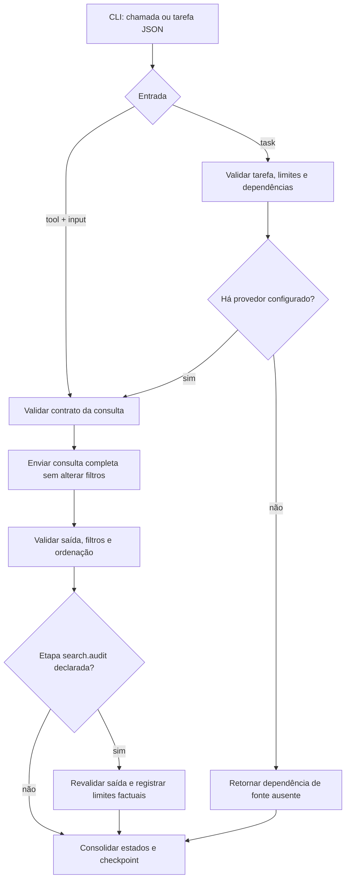

# Coordenação interna de buscas

## Missão e fronteiras

O CLI aceita uma tarefa `{"task": ...}` para organizar consultas e auditorias no próprio runtime de Busca. Uma etapa `search.query` recebe a entrada normal do contrato v1. Uma etapa interna `search.audit` depende explicitamente de uma consulta concluída e revalida a saída contra os filtros e a ordenação declarados naquela consulta.

A coordenação mantém entrada, filtros e ordenação como dados explícitos. Não transforma resultados em instruções nem repassa candidatos como uma nova consulta. Não cria subagentes, não mantém whitelist global de fontes e não grava tarefas ou resultados em disco. A auditoria desta etapa confere contrato, correspondência dos filtros e registro de ordenação; não prova veracidade factual nem substitui a auditoria independente do agente Validação.

## Entradas, estados e dependências

A entrada fica em `contracts/v1/task.schema.json`: IDs únicos, até oito etapas e dependências anteriores. Consultas permanecem independentes e levam a entrada completa do usuário; o estágio de auditoria nomeia exatamente uma etapa `search.query` anterior. A saída `contracts/v1/task-result.schema.json` registra task ID, estado por etapa, resultados, dependências ausentes, limites e checkpoint.

Um provedor real só é chamado quando o host configura a interface `SearchProvider`; sem ele, o runtime retorna `source_unavailable`, marca a tarefa como bloqueada e não relaxa filtros. Fixtures são marcadas `simulated` e não são resultados de busca. Etapas de auditoria só aceitam uma saída de consulta já validada. Resultados parciais continuam identificados como parciais.

O contrato v1 atual apresenta um único registro de ordenação por resultado. Por isso, a coordenação falha fechada antes da consulta quando a solicitação pede múltiplas chaves de ordenação: não alega que toda a ordenação foi auditada. A alteração do contrato público necessária para evidenciar múltiplas chaves requer uma entrega separada; até lá, não reduzir silenciosamente os critérios.

## Limites e retomada

| Limite | Padrão | Teto/condição |
| --- | ---: | --- |
| Bytes de entrada JSON | — | 80.000 |
| Etapas | 8 | 8 |
| Tempo por tarefa | 60 s | 60 s, limite restante enviado ao provedor |
| Tentativas por consulta | 1 | 2 somente para erro recuperável explícito |
| Concorrência dentro da tarefa | 1 | 1 |
| Profundidade de delegação | 0 | 0 |
| Saída total JSON | 256.000 bytes | configurável entre 1.024 e 256.000 |

O cancelamento é cooperativo; o provedor deve observar o evento e o limite de tempo. O cliente valida o retorno do provedor antes da auditoria local e cada etapa de auditoria retorna apenas um resumo, mantendo resultados parciais explícitos.

O checkpoint contém hashes do objetivo, das etapas e das saídas, não valores de resultados. Ao retomá-lo, a consulta é repetida e o resultado é comparado com o hash anterior; se a fonte mudou, a etapa falha explicitamente em vez de reutilizar dados antigos como prova. Consultas não escrevem em fontes. Sem estado local persistido, o checkpoint não autentica nem prova quem executou uma consulta.

## Fluxo

## Avaliação e rastreabilidade

Testes sintéticos comparam consulta direta com consulta seguida de auditoria. O caminho do CLI sem provedor confirma apenas o bloqueio correto. A fixture de resposta parcial permanece marcada como simulada; não há fonte live configurada e nenhum resultado factual é alegado. O caso de múltiplas chaves verifica bloqueio anterior ao provedor, preservando os critérios sem relaxamento.

- Requisitos: [REQUIREMENTS.md](REQUIREMENTS.md), em especial filtros, evidência, N02, N05 e N06.
- Arquitetura: [ARCHITECTURE_PLAN.md](ARCHITECTURE_PLAN.md).
- Especialidades: [SPECIALIZATIONS.md](SPECIALIZATIONS.md).
- Filtros e ordenação: [contrato MCP v1](../contracts/v1/README.md).
- Entrega: [issue #37](https://github.com/PHnsilva/sofiee-agent-search/issues/37), S6, L=8. PR #36 é a base técnica aberta; a pilha continua sujeita à revisão e aceite de Pedro.
